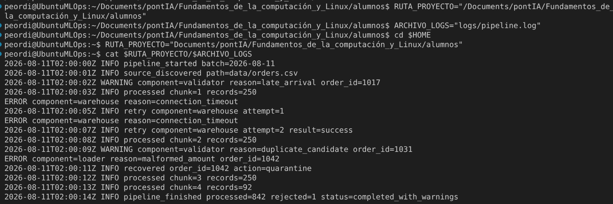
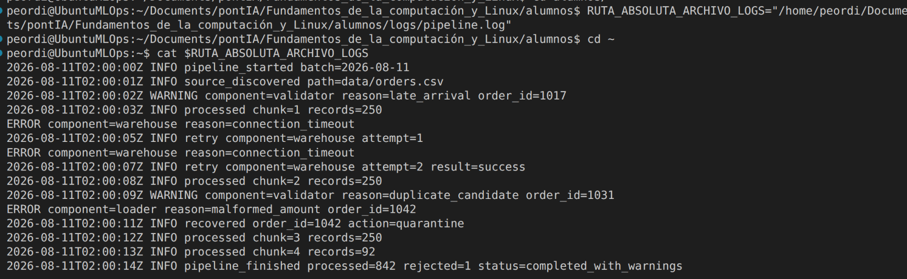
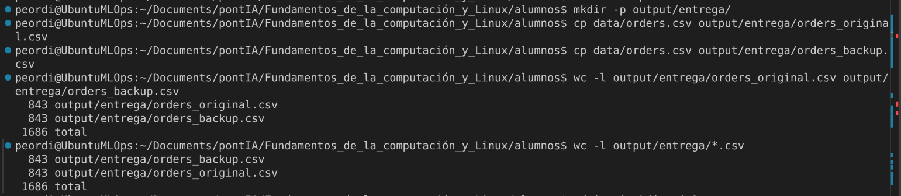
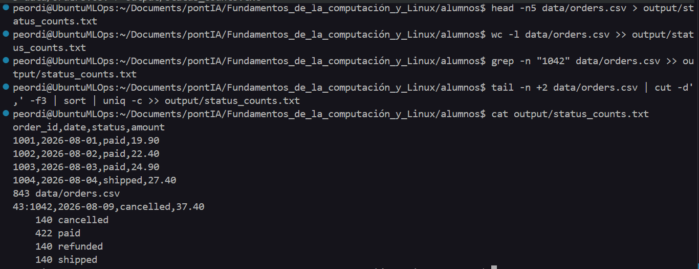
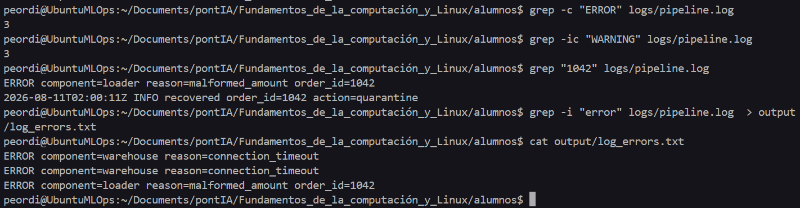
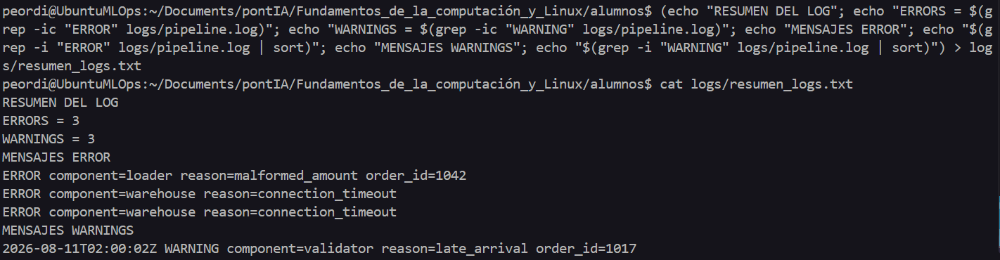
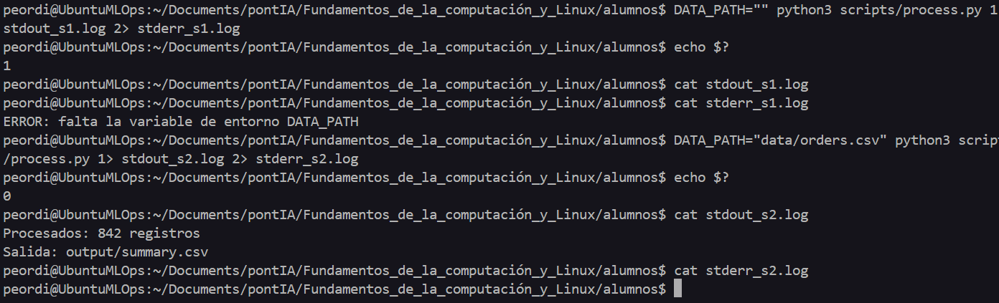
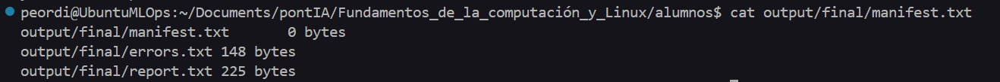
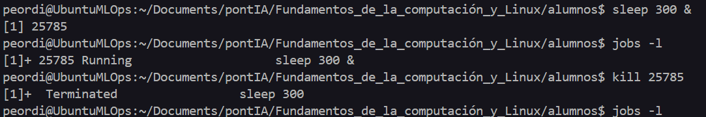

# Entrega Práctica: Fundamentos de Terminal y Linux
**Máster en Data Engineering, MLOps & Arquitectura Cloud - PontIA**

---

## Ejercicio 1: Disecciona un comando Hola

**Enunciado:**  
Explica cada una de las partes del siguiente comando:
`$ grep -in "ERROR" logs/pipeline.log`

* **Señala:** comando, opciones, patrón y archivo.
* **Explica:** ¿Qué cambia si se ejecuta sin `-i`? ¿Y sin `-n`?

### Comando ejecutado:
```bash
grep -in "ERROR" logs/pipeline.log
```

### Explicación / Respuestas:
* **Comando:** `grep`: comando que se utiliza para buscar un texto dentro de un archivo
* **Opciones:** `-in`: con -i ignoras si el texto está en mayúsculas o minúsculas y con -n númera la fila en la cual sale ese texto que buscas
* **Patrón:** `"ERROR"`: el texto a buscar
* **Archivo:** `logs/pipeline.log`: la ruta dónde queremos buscar el texto
* **¿Qué cambia sin `-i`?:** sin -i solamente aparecen las líneas dónde aparece el texto "ERROR"
* **¿Qué cambia sin `-n`?:** realmente nada, ya que -i ignora mayúsculas y minúsculas y como en este caso todas las palabras encontradas se llaman "ERROR", igual que el texto que queríamos buscar, parece que no pase nada. Si en el documento hubiera un texto escrito como "error", sí que veríamos la diferencia.

### Captura demostrativa:


---

## Ejercicio 2: Dos rutas al mismo archivo

**Enunciado:**  
Accede al archivo `logs/pipeline.log` probando dos caminos distintos:
* **Camino A:** Desde la raíz (`HOME`), accede usando una ruta relativa apoyándote en variables de entorno (`logs/pipeline.log`).
* **Camino B:** Desde `~`, accede usando una ruta absoluta y regresa.

### Comandos ejecutados CAMINO A:
```bash
RUTA_PROYECTO="Documents/pontIA/Fundamentos_de_la_computación_y_Linux/alumnos"
ARCHIVO_LOGS="logs/pipeline.log"
cd $HOME
cat $RUTA_PROYECTO/$ARCHIVO_LOGS
```

### Comandos ejecutados CAMINO B:
```bash
RUTA_ABSOLUTA_ARCHIVO_LOGS="/home/peordi/Documents/pontIA/Fundamentos_de_la_computación_y_Linux/alumnos/logs/pipeline.log"
cd ~
cat $RUTA_ABSOLUTA_ARCHIVO_LOGS
cd -
```

### Captura demostrativa:

**CAMINO A:**


**CAMINO B:**


---

## Ejercicio 3: Prepara una entrega segura

**Enunciado:**  
1. Crea la estructura de directorios `output/entrega/` usando el comando `mkdir -p`.
2. Copia dos veces el archivo `data/orders.csv` dentro de `output/entrega/` asignándoles los nombres `orders_original.csv` y `orders_backup.csv`.
3. Verifica y asegura que ambos archivos tienen exactamente el mismo número de líneas mediante un comando de recuento (`wc -l`).

### Comando ejecutado:
```bash
mkdir -p output/entrega/
cp data/orders.csv output/entrega/orders_original.csv && cp data/orders.csv output/entrega/orders_backup.csv
wc -l output/entrega/orders_original.csv output/entrega/orders_backup.csv 
```

### Captura demostrativa:


---

## Ejercicio 4: Audita el CSV

**Enunciado:**  
Guarda en el archivo `output/status_counts.txt` la auditoría del fichero `data/orders.csv` obteniendo los siguientes puntos:
1. Cabecera + 4 filas del archivo.
2. Número total de registros.
3. Búsqueda del pedido `1042` indicando su número de línea.
4. Resumen de pedidos agrupados por estado (ej: recuento + estado) asegurando que contenga 4 estados (Pista: usar la cadena de comandos `tail`, `cut`, `sort` y `uniq`).

### Comando ejecutado:
```bash
1. head -n5 data/orders.csv > output/status_counts.txt
2. wc -l data/orders.csv >> output/status_counts.txt
3. grep -n "1042" data/orders.csv >> output/status_counts.txt 
4. tail -n +2 data/orders.csv | cut -d',' -f3 | sort | uniq -c >> output/status_counts.txt
```

### Captura demostrativa: 
 
---

## Ejercicio 5: Investiga el log

**Enunciado:**  
Obtén las siguientes comprobaciones del archivo `logs/pipeline.log`:
1. Número de veces que aparece exactamente la palabra "ERROR".
2. Número de ocurrencias de la palabra "WARNING" (sin importar mayúsculas o minúsculas).
3. Buscar las referencias correspondientes al `order id = 1042`.
4. Filtrar y guardar únicamente los registros de error en el archivo `output/log_errors.txt` (debe contener exactamente 3 líneas).

### Comando ejecutado:
```bash
1. grep -c "ERROR" logs/pipeline.log
2. grep -ic "WARNING" logs/pipeline.log
3. grep "1042" logs/pipeline.log
4. grep -i "error" logs/pipeline.log  > output/log_errors.txt
```

### Captura demostrativa:


---

## Ejercicio 6: Construye un informe del log

**Enunciado:**  
Genera un archivo de resumen a partir del log `logs/pipeline.log` estructurado con la siguiente información:
* **Cabecera:** `RESUMEN DEL LOG`
* **Recuentos:** `ERRORS = 3` y `WARNINGS = 2`
* **Mensajes:** Añade los mensajes de error ordenados al final del archivo sin sobrescribir el contenido previo (`>>`).

### Comando ejecutado:
```bash
(echo "RESUMEN DEL LOG"; echo "ERRORS = $(grep -ic "ERROR" logs/pipeline.log)"; echo "WARNINGS = $(grep -ic "WARNING" logs/pipeline.log)"; echo "MENSAJES ERROR"; echo "$(g
rep -i "ERROR" logs/pipeline.log | sort)"; echo "MENSAJES WARNINGS"; echo "$(grep -i "WARNING" logs/pipeline.log | sort)") > log
s/resumen_logs.txt 
```

### Captura demostrativa:


---

## Ejercicio 7: Separa stdout y stderr

**Enunciado:**  
Ejecuta el script de Python `scripts/process.py` comprobando los códigos de salida (`$?`), la salida estándar (`stdout`) y la salida de errores (`stderr`) en dos escenarios distintos:
1. Con la variable `DATA_PATH` vacía.
2. Definiendo `DATA_PATH=data/orders.csv`.
* Comprueba si el archivo `summary.csv` ha sido generado al finalizar.

### Comando ejecutado:
```bash
Con la salida estándar es >1 y con la salida de errores es >2

1. 
DATA_PATH="" python3 scripts/process.py 1> stdout_s1.log 2> stderr_s1.log
echo $?
cat stdout_s1.log
cat stderr_s1.log

2.
DATA_PATH="data/orders.csv" python3 scripts/process.py 1> stdout_s2.log 2> stderr_s2.log
echo $?
cat stdout_s2.log
cat stderr_s2.log
```

### Captura demostrativa:


---

## Ejercicio 8: Pipeline final reproducible

**Enunciado:**  
Realiza el flujo completo del pipeline ejecutando los siguientes pasos:
1. Carga las variables desde el archivo de configuración `config/pipeline.env` (usando `set` / `export`).
2. Ejecuta el script `scripts/generate_report.sh`.
3. Copia los resultados generados en la carpeta `output/final/`.
4. Extrae los registros de error usando `grep` y guárdalos en `output/final/errors.txt`.
5. Crea un archivo manifest `output/final/manifest.txt` con los nombres y tamaños de todos los entregables usando el comando `find`.

### Comando ejecutado:
```bash
1. 
set -a
source config/pipeline.env
set +a

2.
bash scripts/generate_report.sh

3.
mkdir -p output/final
cp output/report.txt output/final/

4.
grep -i "error" output/report.txt > output/final/errors.txt

5.
find output/final -type f -printf "%p\t%s bytes\n" > output/final/manifest.txt 
```

### Captura demostrativa:


---

## Ejercicio 9: Observa y termina un proceso

**Enunciado:**  
1. Lanza el comando `sleep 300` en segundo plano (`&`).
2. Identifica el job y su número de PID usando los comandos `jobs` o `ps`.
3. Finaliza el proceso utilizando el comando `kill` enviando la señal `SIGTERM`.
4. Comprueba que el proceso ha sido terminado correctamente.

### Comando ejecutado:
```bash
1. sleep 300 &
2. jobs -l
3. kill 25785
4. jobs -l
```

### Captura demostrativa:


---

## Ejercicio 10: Encuentra artefactos y espacio

**Enunciado:**  
Utiliza las herramientas `find` y `du` para generar dos archivos de diagnóstico:
1. `output/artifacts.txt`: Listado ordenado con la localización de todos los archivos `.txt` y `.csv`.
2. `output/disk_usage.txt`: Comparativa del uso de espacio en disco de los directorios `data/`, `logs/` y `output/`.

### Comando ejecutado:
```bash
# Escribe aquí los comandos ejecutados
```

### Captura demostrativa:


---

## Ejercicio 11: Empaqueta y verifica

**Enunciado:**  
1. Utiliza el comando `tar` para comprimir únicamente el contenido del directorio `output/final/` generando el archivo `output/entrega.tar.gz`.
2. Inspecciona y lista el contenido del archivo comprimido sin extraerlo, guardando dicha salida en `output/archive_contents.txt`.

### Comando ejecutado:
```bash
# Escribe aquí los comandos ejecutados
```

### Captura demostrativa:


---

## Ejercicio 12: Usar * y borrado seguro

**Enunciado:**  
1. Genera la estructura de prueba en `output/sandbox/` con los archivos `a.tmp`, `b.tmp` y `conservar.txt`.
2. Verifica previamente qué archivos selecciona el patrón `*.tmp`.
3. Elimina de golpe únicamente los archivos con extensión `.tmp` usando el comodín `*` y lista de nuevo para comprobar el resultado.
4. Elimina la carpeta `sandbox/` por completo junto a su contenido restante.

### Comando ejecutado:
```bash
# Escribe aquí los comandos ejecutados
```

### Captura demostrativa:


